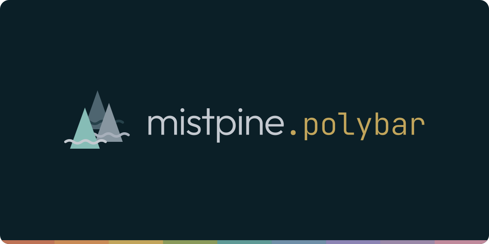
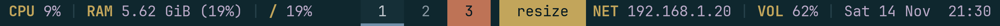

<p align="center">
  
</p>

<p align="center">
  
</p>

**mistpine** for [Polybar](https://github.com/polybar/polybar): cool, misty
grays over a deep blue-green night, with muted, earthy accents. It is the
Polybar port of [mistpine](https://github.com/mistpine/mistpine) and follows
the [mistpine spec](https://github.com/mistpine/mistpine/blob/main/docs/spec.md):
every color is the spec's, generated from its palette file and checked
against Polybar itself.

- `mistpine.ini`: a `[colors]` section with the palette, plus the names
  Polybar's default config reads (`background`, `foreground`, `primary`,
  `alert`, `disabled`…), so that config turns mistpine as is.
- An example bar for i3, the one in the screenshot: a status line like
  mistpine's Neovim, workspaces like the windows in
  [mistpine.sway](https://github.com/mistpine/mistpine.sway), and the same
  look as [mistpine.waybar](https://github.com/mistpine/mistpine.waybar).
- Polybar 3.7.1 and later.

The screenshot is the real app, Polybar 3.7.2 on i3, and the render fails if
a single color comes out different from the spec.

## Install

```sh
mkdir -p ~/.config/polybar
curl -fsSL -o ~/.config/polybar/mistpine.ini \
  https://raw.githubusercontent.com/mistpine/mistpine.polybar/main/themes/mistpine.ini
```

Then include it at the top of `~/.config/polybar/config.ini`, and remove your
own `[colors]` section:

```ini
include-file = ~/.config/polybar/mistpine.ini
```

Use the colors as references, `${colors.bg2}`, anywhere a whole value is a
color. Polybar cannot read references inside `%{F…}` tags in a label; color
a module with `format-prefix-foreground` and `label-foreground` instead, as
the example does.

For the bar in the screenshot, take the example too, and start it with
`polybar mistpine`:

```sh
curl -fsSL -o ~/.config/polybar/config.ini \
  https://raw.githubusercontent.com/mistpine/mistpine.polybar/main/examples/config.ini
```

It replaces your `config.ini`; keep a copy first. It is written for i3 and a
wireless network; change `modules-center` and `interface-type` to suit.

## Colors

The palette, as `${colors.<name>}`:

| Names | Colors |
| --- | --- |
| `bg0` … `bg4` | `#071921` `#0b1f27` `#0f272e` `#152f37` `#26414a` |
| `fg0` … `fg3` | `#4e6570` `#8796a0` `#a7b0bb` `#c4c9d0` |
| `red` `orange` `yellow` `green` | `#be7356` `#c98b56` `#c2a55b` `#8a9a5b` |
| `cyan` `blue` `purple` `pink` | `#5f9a96` `#6f8fa8` `#8c84b4` `#c08a9c` |
| `bright-red` `bright-green` `bright-yellow` | `#d08a6e` `#a9b97a` `#dcc27e` |
| `bright-blue` `bright-purple` `bright-cyan` | `#93afc4` `#b8a8c6` `#86bcb6` |

And Polybar's own names:

| Name | mistpine | Role |
| --- | --- | --- |
| `background` | `bg2` | the bar, a status line |
| `background-alt` | `bg3` | raised: the focused workspace |
| `foreground` | `fg2` | text on the bar |
| `primary` | `yellow` | labels and highlights |
| `secondary` | `blue` | the accent |
| `alert` | `red` | urgent and failing |
| `disabled` | `fg1` | idle, empty, offline |

The example colors labels in bold `yellow` and values in `bright-purple`:
plain `purple` sits at 4.49:1 on the bar, just under the spec's 4.5:1.

## Development

Requires Node 24+, pnpm (`corepack enable`) and Docker.

The spec loader, color math, banner and pixel checks come from
[@mistpine/port-kit](https://github.com/mistpine/port-kit), shared by every
mistpine port.

```sh
pnpm install
pnpm generate  # themes/ and examples/ from the mistpine spec and src/
pnpm check     # fail if they are out of date
pnpm verify    # Polybar 3.7.1 and 3.7.2 load them and show the spec's colors
pnpm render    # the README screenshot from Polybar, with pixel checks
pnpm banner    # assets/banner.svg and the social preview (Chromium)
pnpm lint && pnpm typecheck
```

Never edit `themes/` or `examples/` by hand. The example lives in
`src/config.ini` and may use colors only as `${colors.*}` references.
`scripts/generate.ts` reads the palette from
[`palette/mistpine.json`](https://github.com/mistpine/mistpine/blob/main/palette/mistpine.json)
(from `$MISTPINE_DIR`, `../mistpine` or GitHub), writes the files and
requires 4.5:1 for every text color on its background.

`pnpm verify` and `pnpm render` run Polybar on i3 on Xvfb in Docker: Ubuntu
24.04 for Polybar 3.7.1, Ubuntu 26.04 for Polybar 3.7.2
(`scripts/render/Dockerfile`). verify loads the shipped example unchanged,
fails on any warning or error but the container's own (no wireless card, no
PulseAudio, one screen), asks Polybar to `--dump` the bar's resolved colors,
and checks them on screen. render shows the bar at 288 dpi with fixed values
for the network, volume and date modules (`scripts/render/render.ini`),
checks every role's pixels, and crops the 26.04 shot for the README.

## Credits

- Designed in [themes.utimura.io](https://themes.utimura.io).
- [Outfit](https://github.com/Outfitio/Outfit-Fonts) and
  [JetBrains Mono](https://github.com/JetBrains/JetBrainsMono) in the banner.
  The screenshot uses JetBrains Mono.

## License

[MIT](LICENSE).
